<p align="center">
  <picture>
    <source media="(prefers-color-scheme: dark)" srcset="docs/design/icon/nitpick-icon-dark.svg">
    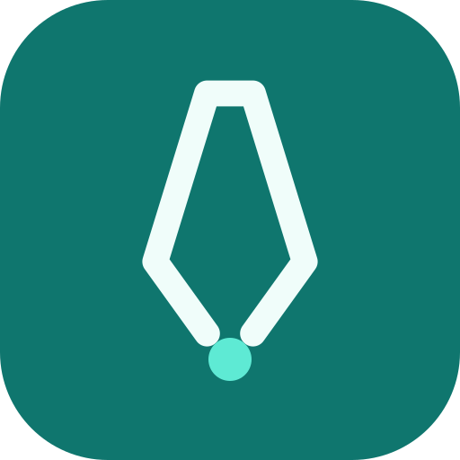
  </picture>
</p>

<h1 align="center">Nitpick</h1>

<p align="center"><b>Nitpick your branch before main does.</b></p>

<p align="center">
  A visual git client for desktop and Android, built with Kotlin Multiplatform, that has an AI
  review your current branch <b>locally, before you push</b>: comments anchored on lines like a
  pull-request review (<i>nits</i>), and suggestions you apply in one click.
</p>

<p align="center">
  
  
  
  
  
  
  
  
  <a href="https://github.com/Nitpick-org/nitpick-core/actions/workflows/ci.yml"></a>
</p>

<p align="center">
  
  
  
  
  
  
  
</p>

<p align="center">
  Built in 24 hours at <a href="https://lauzhack.com/">LauzHack 2026</a> (EPFL, 21–22 November 2026)
  for the <b>JetBrains Kotlin Multiplatform</b> challenge.
</p>

<p align="center">
  <picture>
    <source media="(prefers-color-scheme: dark)" srcset="docs/demo/desktop-review-dark.png">
    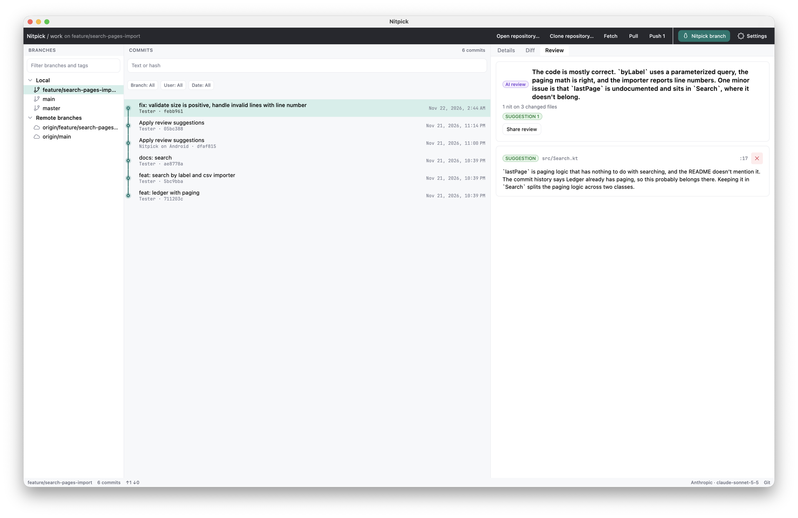
  </picture>
</p>

## Demo video

<p align="center">
  <a href="https://www.youtube.com/watch?v=s9VNiOdvKN4">
    
  </a>
  <br><sub>▶ Watch the demo on YouTube</sub>
</p>

---

## Contents

- [Demo video](#demo-video)
- [Why](#why)
- [At a glance](#at-a-glance)
- [Status](#status)
- [Platforms](#platforms)
- [Features](#features)
- [Screenshots](#screenshots)
- [Architecture](#architecture)
- [How a review works](#how-a-review-works)
- [Sharing a review between devices](#sharing-a-review-between-devices)
- [Security and privacy](#security-and-privacy)
- [Tech stack](#tech-stack)
- [Run it](#run-it)
- [Tests and proof](#tests-and-proof)
- [How we built it: 3 humans, many agents](#how-we-built-it-3-humans-many-agents)
- [Repository map](#repository-map)
- [Created during the event vs reused](#created-during-the-event-vs-reused)
- [Team](#team)
- [License](#license)

## Why

Coding agents write more of what lands on `main`, and fewer people read it end to end.
AI review tools such as CodeRabbit, Copilot review or Graphite run **after** the push, on the
pull request, on a server. Nitpick runs **before** the push, on your machine, with the
repository's context, and talks to the provider you pick: Anthropic, OpenAI, Google,
Ollama running locally, or JetBrains Junie through the Junie CLI already signed in on your
machine (desktop).

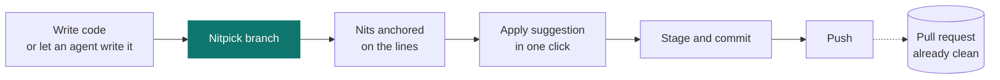

## At a glance

| | |
| --- | --- |
| **Shared code** | **97.6 %** of production lines shared between desktop and Android (9 138 / 9 366, `./scripts/count-lines.sh`, `commonMain` + `jvmSharedMain`); 228 platform-specific lines, most of them the desktop-only Junie CLI client |
| **Targets** | Desktop (macOS, Windows, Linux) · Android (API 33+) · Ktor server |
| **LLM providers** | Anthropic · OpenAI · Google · Ollama (via Koog) · JetBrains Junie (Junie CLI, desktop) |
| **Tests** | 237 test cases: shared JVM tests, 13 Ktor server tests, 4 instrumented tests on Android ART; `check.sh` runs on every PR and on `main` in GitHub Actions |
| **i18n** | English + French: 196 strings and 7 plurals in each language |
| **Process** | 404 commits, 135 merged PRs, 110 GitHub issues, one journal per ticket in `progress/` |

## Status

> Updated at each team sync. Only what runs today is listed as done.

| Piece | State |
| --- | --- |
| KMP project (desktop + Android, shared Compose UI) | ✅ generated, builds on both targets |
| JGit behind a shared source set (`jvmSharedMain`) | ✅ log, diff, stage, commit, fetch/pull/push and checkout run on desktop and Android (emulator, API 36) |
| Shared contracts (`GitRepository`, review model) | ✅ in `commonMain`, JGit behind the interface |
| Commit graph, branch diff | ✅ lanes, colours, refs, per-commit details, diff vs base |
| AI review with Koog, anchored nits, apply a suggestion, commit | ✅ real provider calls, snippet anchoring, Review panel, Apply/Dismiss, commit |
| Light/dark theme, English/French | ✅ system/light/dark, 196 strings + 7 plurals EN/FR |
| JetBrains Junie as a review provider | ✅ desktop, through the Junie CLI (`junie-lite`, sandboxed); greyed on Android |

Full scope (MUST / SHOULD / WON'T) and the hour-by-hour plan: [docs/CONTEXT.md](docs/CONTEXT.md).

## Platforms

| Target | Role |
| --- | --- |
| Desktop (macOS, Windows, Linux) | The main app: full git client + AI review |
| Android | Review on the go: clone over HTTPS with a token, see the graph, run the review, accept suggestions, commit and push |
| Kotlin server (Ktor) | Shares a finished review between devices and teammates; the review itself still runs locally |
| iOS, web | Out of scope: JGit does not run there |

## Features

### Git client (desktop and Android, one JGit implementation)

- **Open** a local repository (native folder picker on desktop) or **clone** one over HTTPS,
  with progress; recent repositories are remembered.
- **Commit graph**: lanes, colours, merge and octopus commits, branch/tag/remote refs,
  per-commit details. **Filters** by text, hash or branch.
- **Branch diff** against the **fork point** (merge-base) plus the working tree, not the tip of
  `main`, so files from `main` never show up as deleted.
- **Stage, commit, fetch, pull, push, checkout**, and **publish** a branch that has no upstream.
- **Sync status**: ahead/behind the upstream, animated Fetch/Pull/Push icons, a "pushed" banner.
- **Safe by default**: pull is fast-forward only on a dirty tree, a checkout conflict lists the
  blocking files, SSH remotes are refused with a sentence instead of a stack trace.

### AI review

- **"Nitpick branch"**: one button reviews the current branch against its base.
- **Nits anchored on lines**, with severity (`BUG`, `WARNING`, `SUGGESTION`, `INFO`), category
  and per-severity counts; a nit that cannot be anchored becomes a **whole-file** comment.
- **Inline nits in the desktop diff**, a grouped list and a bottom sheet on the phone.
- **Before/after suggestion** (`-` / `+` lines), **Apply** or **Dismiss**, **Apply all** for a
  file; the other nits are re-anchored after each apply.
- **Stage & commit** the applied suggestions with a message built from the nits' titles.
- **Read-only tools**: the model may call `list_files` and `read_file` to look at a neighbouring
  file; each tool call is shown in the Review panel.
- **Clear failure states**: missing key, network, timeout, provider error.
- **Tolerant parsing**: the answer's JSON object is found even inside prose or fences, and
  even when that prose contains a brace of its own.
- **Four providers** through [Koog](https://github.com/JetBrains/koog): Anthropic, OpenAI,
  Google, Ollama, picked by their marks in the settings.
- **JetBrains Junie** as a fifth provider on desktop, through the Junie CLI signed in on the
  machine (`junie-lite` free tier, `sonnet`, `opus`). Junie runs in an empty temporary project
  and reads the prompt from a file there: it never sees nor edits the open repository. On
  Android, where there is no CLI, the entry stays greyed with the reason.

### Accounts, sharing and settings

- **GitHub / GitLab sign-in** through the OAuth device flow (RFC 8628) on the phone, or a
  personal token on desktop.
- **Share a review** through the Ktor server; open it on another device **without calling the
  model again**, then apply its suggestions there.
- **Settings**: theme (system/light/dark), language (system/English/French), provider, model,
  API key, git account, sharing server URL and token, About page (team, repository, credit
  to [socraft](https://socraft.ch) with a themed, clickable logo).
- **JetBrains New UI design system**: teal accent, JetBrains Mono, custom icons, animated
  loader, a component catalogue (`ui/designsystem/`).

## Screenshots

<table>
  <tr>
    <td align="center">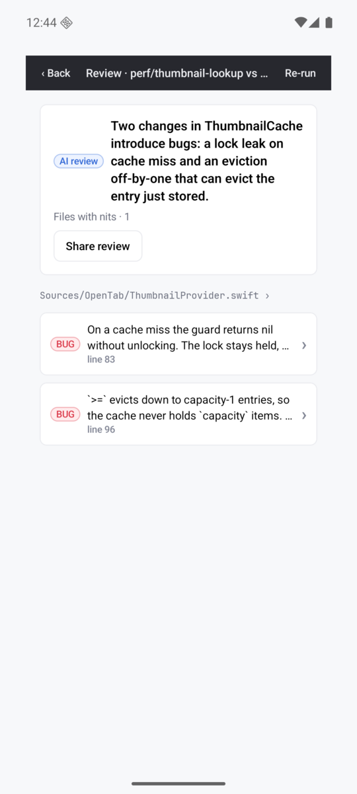<br><sub>Review on the phone</sub></td>
    <td align="center">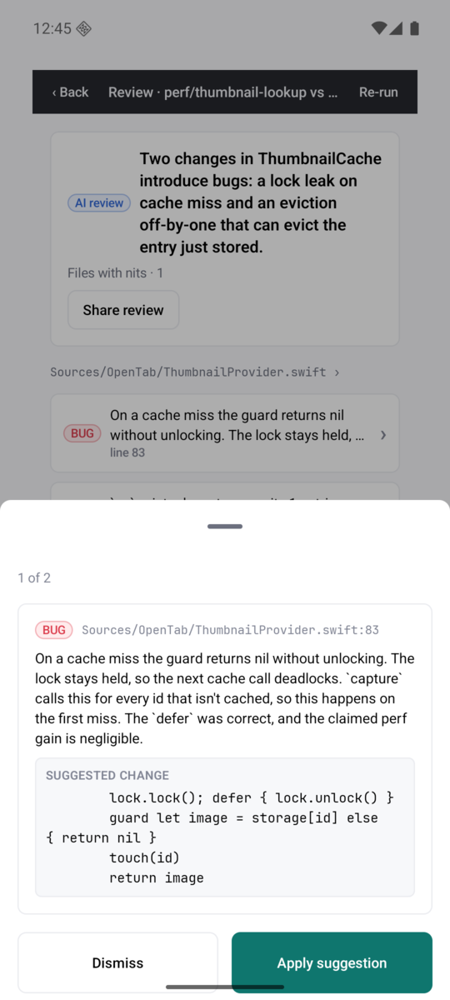<br><sub>A nit and its suggestion</sub></td>
    <td align="center">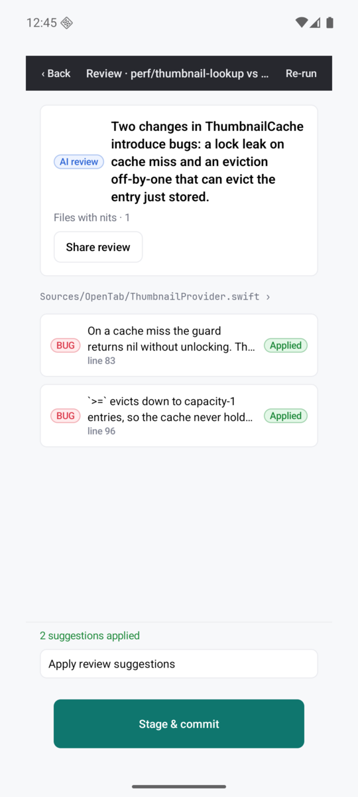<br><sub>Suggestions applied</sub></td>
    <td align="center">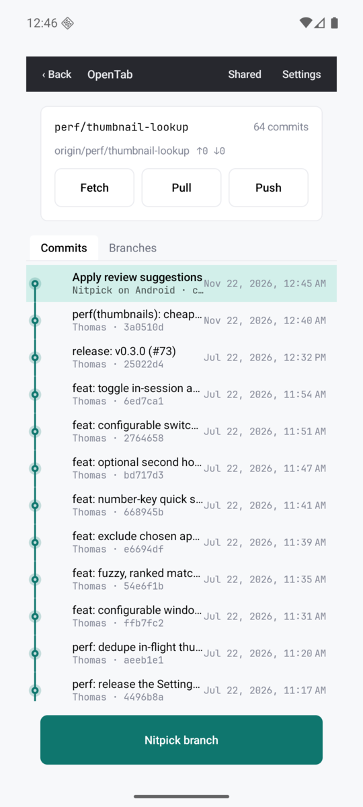<br><sub>Graph after the push</sub></td>
  </tr>
  <tr>
    <td align="center">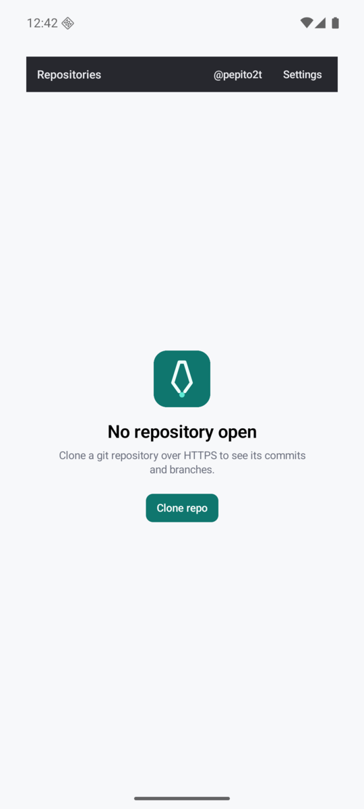<br><sub>Repositories, signed in</sub></td>
    <td align="center">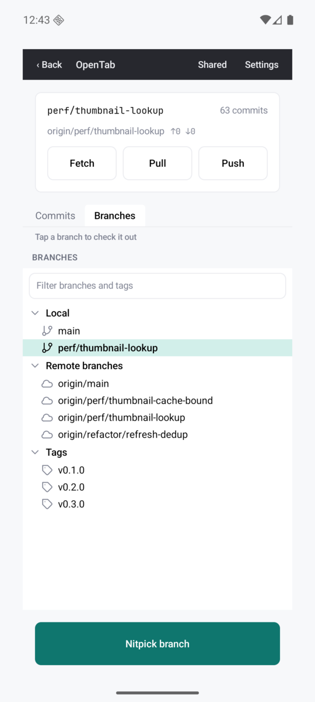<br><sub>Branch card and checkout</sub></td>
    <td align="center">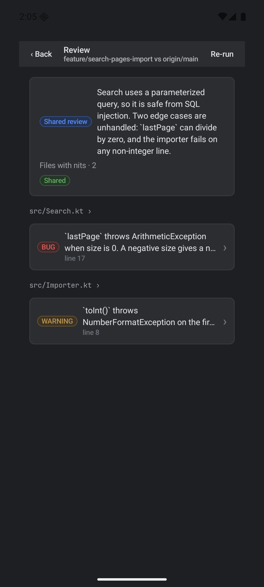<br><sub>A shared review opened</sub></td>
    <td align="center">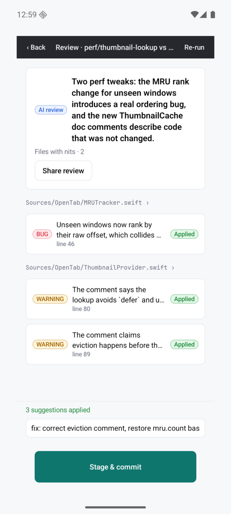<br><sub>Commit message from the nits</sub></td>
  </tr>
</table>

All captures: [`docs/demo/`](docs/demo/).

## Architecture

As much as possible lives in `commonMain`; platform code stays thin. JGit sits in an
intermediate source set, `jvmSharedMain`, that **both** desktop and Android compile, so there is
a single git implementation.

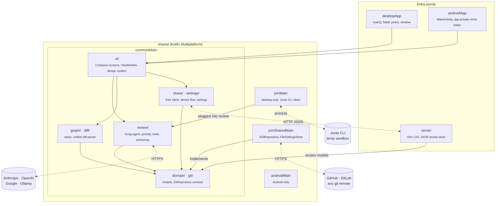

```text
shared/src/commonMain/kotlin/dev/nitpick/app/
  domain/      Commit, Ref, FileDiff, ReviewResult, ReviewComment, SharedReview…
  git/         GitRepository + GitRepositoryFactory: the only door to git
  graph/       commit graph lanes, one pass
  diff/        unified diff parser
  review/      LlmReviewAgent, KoogLlmClient, ReviewContext, ReviewPrompt, ReviewToolbox,
               ReviewResponseParser, ReviewAnchoring (+ LocalReviewAgent, a test fallback)
  share/       ReviewShareClient + its Ktor implementation
  settings/    Settings, SettingsStore, ForgeClient (device flow), known models
  ui/          App, repository/ (desktop), phone/ (Android flow), settings/, components/,
               theme/, designsystem/
  AppContainer manual dependency injection
shared/src/commonMain/composeResources/   EN strings (values/), FR (values-fr/), icons, fonts
shared/src/jvmSharedMain/                 JGitRepository, FileSettingsStore
desktopApp/   androidApp/   server/
```

Rules the code follows:

- **No `org.eclipse.jgit` import outside `jvmSharedMain`.** The rest of the app only sees the
  `GitRepository` interface.
- **Shared AI logic**: the review agent, the repo context, the output validation and the code
  that applies a suggestion all live in `commonMain`.
- **One settings file** (`FileSettingsStore`, JSON through `java.io.File`): it works on both
  targets with zero platform code.
- **Deep modules**: a lot of behaviour behind a small interface, tested at that interface.
  The UI composes ViewModels (immutable state, intents, `StateFlow`); git and LLM calls run off
  the UI thread.

## How a review works

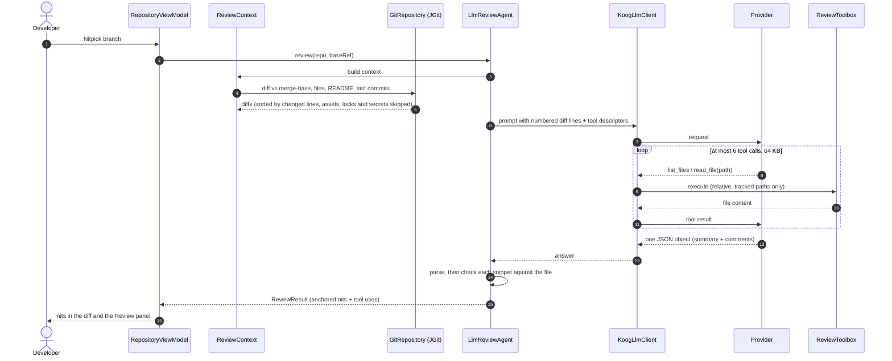

**Reliable anchoring** is the part that makes a nit trustworthy:

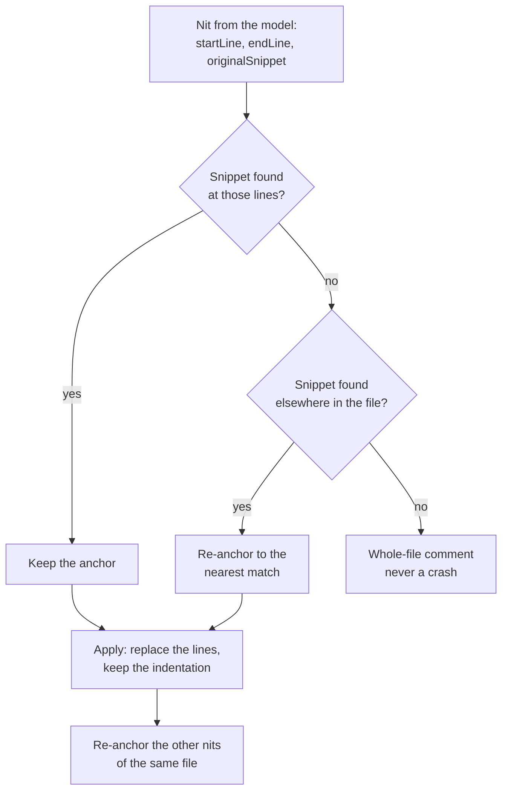

The LLM sees every diff line prefixed with its new line number and must copy back the
snippet it comments on. Nitpick checks that snippet against the file before showing or
applying anything.

## Sharing a review between devices

The review always runs locally; the server only stores **finished** reviews so a teammate or
your phone can open them. No account, no LLM, nothing logged on the server side.

- **One key per repository**, whatever the clone URL: `git@github.com:o/r.git`,
  `https://github.com/O/R` and `ssh://…:22/o/r` are the same repo (case folded on GitHub and
  GitLab, default ports dropped, a custom port kept for self-hosted forges).
- **Persistent**: reviews live in `~/.nitpick/server/reviews.json` and survive a restart; keys
  stored under an older rule still match.
- **Forward compatible**: an unknown field from a newer app is ignored, never a 400.

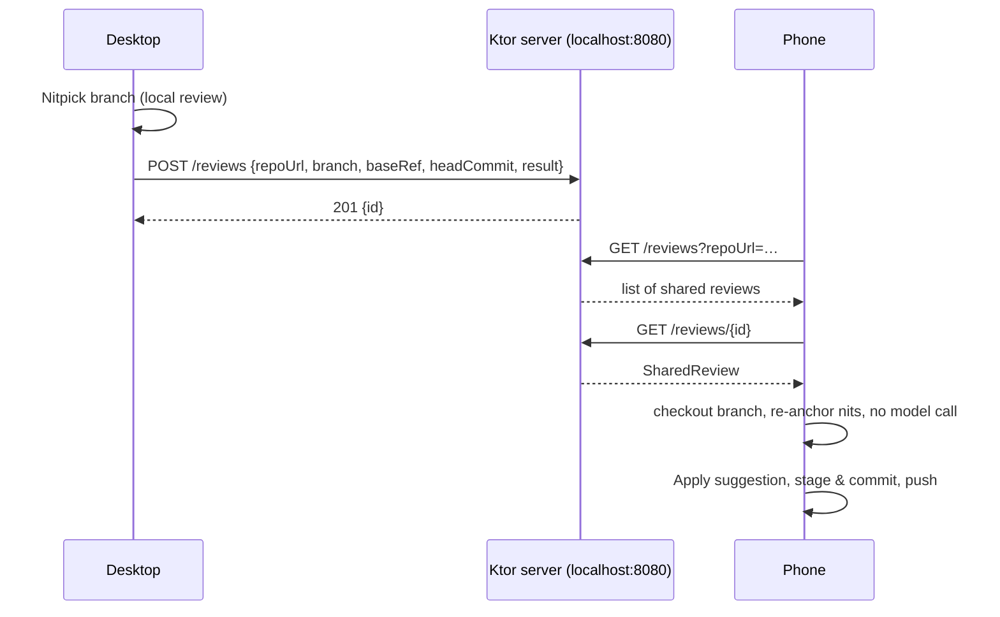

| Route | Purpose |
| --- | --- |
| `GET /health` | liveness |
| `POST /reviews` | share a review (body capped at 1 MB) |
| `GET /reviews?repoUrl=` | list the reviews of a repository |
| `GET /reviews/{id}` | open one review |

The proof of a desktop → Android share, with captures, is in
[`docs/demo/share-proof.md`](docs/demo/share-proof.md).

## Security and privacy

- **Your code goes only to the provider you chose**, or nowhere with Ollama.
- **Junie is sandboxed**: the CLI gets an empty temporary project, never the repository; the
  prompt goes through a file there (not a command-line argument other processes can read),
  and the user's own MCP servers are not loaded.
- **API keys** live in the app settings or the local `.env`; nothing is committed. The repo
  history holds no live secret.
- **Path jail for the LLM**: `ReviewToolbox` refuses absolute paths, `..`, `.git` and untracked
  files; tracked symlinks cannot escape the work tree. Calls and bytes are capped per review.
- **Secrets never enter the prompt**: `.env`, private keys, `local.properties`, keystores are
  skipped even when tracked.
- **Prompt injection**: the system prompt states that the README, commit messages and file
  contents are data, never instructions.
- **Server binds to localhost** by default; LAN mode (`NITPICK_BIND=0.0.0.0`) refuses to start
  without a shared `NITPICK_TOKEN` (Bearer). Repo URLs and ids are validated.

Details: [`docs/audits/security.md`](docs/audits/security.md).

## Tech stack

| Piece | Choice | Version |
| --- | --- | --- |
| Language | Kotlin Multiplatform | 2.4.21 |
| UI | Compose Multiplatform + Material 3 | 1.12.2 |
| Android build | AGP, minSdk 33, targetSdk 37 | 9.1.1 |
| Git | JGit | 6.10.1 |
| AI agents | Koog (+ Google client 1.3.0-beta) | 1.3.0 |
| JetBrains AI | Junie CLI (desktop, flags validated against) | 26.11 |
| CI | GitHub Actions, JDK 21 + Android SDK, runs `check.sh` | — |
| Provider marks | Simple Icons (CC0) | — |
| Backend | Ktor server (CIO) + client | 3.3.3 |
| Serialization, async | kotlinx.serialization, kotlinx.coroutines | 1.13.0, 1.11.0 |
| Font | JetBrains Mono | — |

JGit is pinned to 6.10: JGit 7 ships Java records, which the Android dexer refuses below
API 34 (details in commit `df36830`). Koog's Android AAR lacks the HTTP client service file of
its JVM jar, so `KoogLlmClient` passes the factory explicitly. The packaged desktop bundle
ships every JDK module: a `java.base`-only runtime left JGit hanging on its first pack file.

## Run it

Prerequisites: JDK 17+, the Android SDK with `ANDROID_HOME` set, and an emulator or a
phone for Android. Gradle downloads everything else, including the JDK 21 its daemon runs on.

```bash
git clone https://github.com/Nitpick-org/nitpick-core.git nitpick && cd nitpick
git config core.hooksPath .githooks      # pre-commit runs scripts/check.sh

./gradlew :desktopApp:run                # desktop app
./gradlew :desktopApp:runDistributable   # same, as the packaged bundle (name and icon in the macOS Dock)
./gradlew :androidApp:installDebug       # Android app on the connected device
./gradlew :server:run                    # review-sharing server on localhost:8080

./scripts/check.sh                       # shared tests + desktop and Android builds
./gradlew :androidApp:connectedDebugAndroidTest   # tests on Android (device needed)
./scripts/doctor.sh                      # checks the toolchain and the repo setup
./scripts/count-lines.sh                 # shared vs platform-specific lines
```

API keys are entered in the app's settings and never committed. For the phone to reach the
server over USB: `adb reverse tcp:8080 tcp:8080`. For the Junie provider, install the
[Junie CLI](https://www.jetbrains.com/junie/) and sign in once; Nitpick looks in `~/.local/bin`, `/usr/local/bin`, `/opt/homebrew/bin`, then the `PATH`.

## Tests and proof

| Suite | Where | What it covers |
| --- | --- | --- |
| Shared tests | `shared/src/commonTest`, `shared/src/jvmTest` | graph lanes, diff parser, prompt, context, response parser, anchoring, toolbox jail, Koog client, Junie CLI command and output, ViewModels, settings, device flow, share client, real JGit repositories |
| Server tests | `server/src/test` | routes, validation, body limit, token, repository-key normalisation, corrupt store recovery |
| On-device tests | `androidApp/src/androidTest` | JGit, Koog client and share client running on Android ART |
| Real provider call | `RealReviewCallTest` | opt-in, skipped without a key |

- **Dogfooding**: Nitpick reviewed our own branch `ticket/104` and found a real bug (pull said
  `Aborted` on a dirty diverged tree), fixed in PR #118. 2 nits, 1 true bug, 1 already fixed,
  0 false positives: [`docs/demo/dogfooding.md`](docs/demo/dogfooding.md).
- **Demo repository**: `pepito2t/OpenTab`, branch `perf/thumbnail-lookup`, with two planted
  bugs (a lock never released, an eviction off-by-one); the phone review found both. Plan B:
  `pocket-ledger` with three planted defects, from
  [`docs/demo/junie-brief.md`](docs/demo/junie-brief.md).
- **Android walkthrough** replayed on an API 36 emulator: `docs/demo/android-*.png`.

## How we built it: 3 humans, many agents

The JetBrains challenge rewards an authentic development process, so ours is in the repo.

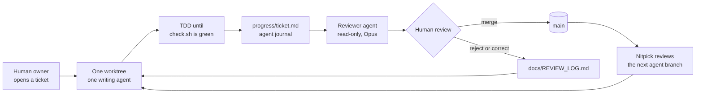

- **Three tracks** work in parallel and only meet through the shared contracts: A (shared
  core: graph, diff, review agent), B (JGit + desktop), C (Android + finishing touches), plus D
  (sharing server).
- **Agents do real work, humans review it.** Each ticket gets its own git worktree and one
  writing agent. A read-only reviewer agent goes over every diff before a human merges it.
- **Specialised sub-agents** in [`.claude/agents/`](.claude/agents/): `architect`,
  `implementer`, `reviewer`, `researcher`, `qa-demo`, `devils-advocate`, `pitch`, `scribe`,
  each with a default model; [`/route-task`](.claude/skills/route-task/) picks the cheapest one
  and escalates on evidence ([`docs/MODEL-ROUTING.md`](docs/MODEL-ROUTING.md)).
- **Hooks and CI enforce the rules**: the session cannot stop while `check.sh` is red, agents
  cannot edit the human-owned docs, nothing reads `.env`, `pre-commit` runs the checks, and
  GitHub Actions runs the same `check.sh` on every PR and on `main`.
- **Claude Code, with Junie in the product**: the code was written with Claude Code and its
  sub-agents. Junie ships inside Nitpick as a review provider; a Junie Lite ticket driven in
  JetBrains Air is briefed in [`docs/demo/junie-lite-brief.md`](docs/demo/junie-lite-brief.md)
  and is not claimed until its captures exist.
- **Everything is logged**: each agent keeps a journal in `progress/<ticket>.md`, compiled
  into [docs/AGENT_LOG.md](docs/AGENT_LOG.md). Every time a human rejects or corrects an
  agent's work, it goes into [docs/REVIEW_LOG.md](docs/REVIEW_LOG.md).
- **Multi-agent comparison**: the commit-graph lanes were written by two independent agents;
  we compared both algorithms and kept the one-pass version.
- **Audits by agents**: a six-lane audit (spec, architecture, demo path, security, UX,
  release) in [`docs/audits/`](docs/audits/), then targeted audits of git, share and review.

The rules every agent follows are in [AGENTS.md](AGENTS.md) (Claude Code adds
[CLAUDE.md](CLAUDE.md)); hooks live in `scripts/` and `.githooks/`.

## Repository map

| Path | What it is |
| --- | --- |
| `shared/`, `desktopApp/`, `androidApp/` | The app |
| `server/` | Ktor review-sharing server |
| [docs/README.md](docs/README.md) | Docs index: current docs first, pre-event history last |
| [docs/CONTEXT.md](docs/CONTEXT.md) | Master project brief: mission, stack, scope, plan, demo (French) |
| [docs/JETBRAINS-CHALLENGE.md](docs/JETBRAINS-CHALLENGE.md) | Official JetBrains KMP challenge brief and how Nitpick maps to it |
| [docs/DESIGN-SYSTEM.md](docs/DESIGN-SYSTEM.md) | JetBrains New UI design system: tokens, components, rules |
| [docs/design/](docs/design/) | UI handoff, mockups, app icon and loader |
| [docs/audits/](docs/audits/) | Spec, architecture, security, UX, release and demo audits |
| [docs/demo/](docs/demo/) | Screenshots, dogfooding and share proofs, demo-repo brief |
| [docs/DEMO.md](docs/DEMO.md) | 3-minute demo script, Q&A, plan B |
| [docs/RESEARCH.md](docs/RESEARCH.md) | Sourced research: Koog, JGit, Compose, the jury |
| [AGENTS.md](AGENTS.md) | Team rules for every agent |
| `progress/` | One journal per ticket, written by the agent working on it |
| `scripts/` | `check.sh`, `doctor.sh`, `count-lines.sh`, worktree and AFK helpers, hook scripts |
| `.claude/` | Claude Code sub-agents, the `/route-task` skill, settings and hooks |
| `dry-run/` | Pre-event rehearsal notes |

Docs, code, comments and commit messages are in English.

## Created during the event vs reused

LauzHack asks every team to state this explicitly.

- **Reused**: the KMP + Compose Multiplatform wizard template, JGit 6.10, Koog 1.3,
  Ktor 3.3, the Junie CLI, JetBrains Mono, Simple Icons marks, and the team's pre-event docs
  and agent tooling.
- **Created during the event**: the domain, graph, diff, review/anchoring, JGit backend,
  Compose UI for desktop and Android, the Koog review agent, the Ktor sharing server, the
  design system, the icons and their tests.
- **Not mocked**: the review path calls a real provider. Anthropic has a recorded real call;
  OpenAI was replayed through LM Studio; Junie answered a probe diff with `junie-lite` (about
  9 s); Google and Ollama are wired but only covered by opt-in tests.

## Team

| Role                                    | GitHub                                           |
| --------------------------------------- | ------------------------------------------------ |
| H1 — Builder, Integration, pitch        | [@dovatgabriel](https://github.com/dovatgabriel) |
| H2 — Builder, Integration, architecture | [@zooldyyk](https://github.com/zooldyyk)         |
| H3 — Builder, Integration, architecture | [@pepito2t](https://github.com/pepito2t)         |

## License

Nitpick is released under the MIT License: see [LICENSE](LICENSE). The third-party
components it depends on or bundles, and their licenses, are listed in
[THIRD-PARTY-NOTICES.md](THIRD-PARTY-NOTICES.md).
